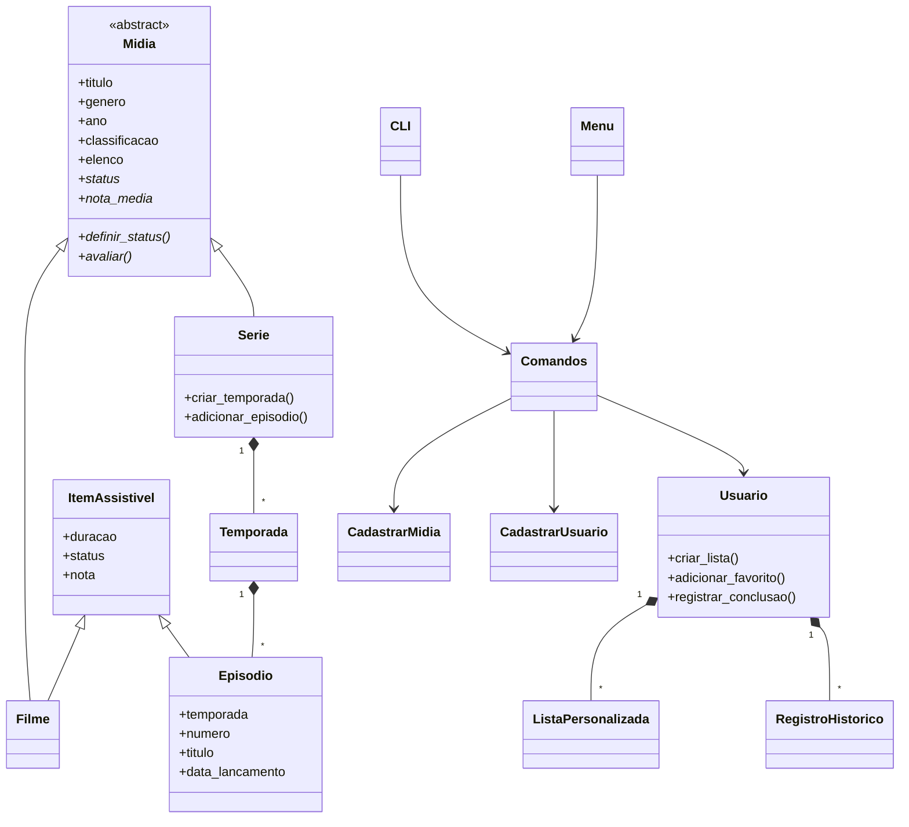

# Tema 10 — Catálogo de Filmes e Séries

Sistema em linha de comando (subcomandos e menu interativo, com login) para gerenciar um **catálogo pessoal de
filmes e séries**: cadastro, temporadas e episódios, avaliações, status de visualização, histórico,
listas personalizadas e relatórios de consumo. Projeto 1 de POO (UFCA).

## Como usar

Python 3.10+, sem dependências para rodar (o `pytest` só é necessário para os testes).

Há duas formas de usar, com a mesma lógica por baixo:

**1. Menu interativo** — sem argumentos. Pergunta passo a passo; ideal para explorar.

```bash
python main.py
```

**2. Subcomandos** — `python main.py <grupo> <ação> [argumentos]`; ideal para scripts e para o dia a dia.
`python main.py -h` mostra tudo e `python main.py midia -h` mostra um grupo.

```bash
python main.py usuario entrar Davi              # login (cria a conta se for nova); fica salvo
python main.py exemplos                         # filmes e séries de exemplo (seed)
python main.py midia adicionar --tipo filme --titulo Matrix --genero "Ficção" --ano 1999 --classificacao 14 --duracao 136
python main.py midia listar --status assistido
python main.py midia avaliar 1 9.5
python main.py serie adicionar-temporada 2 -t 1 --episodios 10 --duracao 50
python main.py serie atualizar-status 2 assistido -t 1 -e 3
python main.py midia relatorio top
```

### Subcomandos

| Comando | O que faz |
|---|---|
| `midia adicionar --tipo filme\|serie --titulo T --genero G --ano A --classificacao C [--duracao M] [--elenco "a, b"]` | Cadastra (`--duracao` só para filmes) |
| `midia listar [--tipo] [--status] [--genero] [--busca]` | Lista e filtra o catálogo |
| `midia avaliar ID NOTA [-t TEMPORADA -e EPISODIO]` | Nota de 0 a 10 para filme ou episódio |
| `midia atualizar-status ID STATUS` | `NÃO ASSISTIDO`, `ASSISTINDO` ou `ASSISTIDO` |
| `midia recomendar` / `midia remover ID` | Sorteia sugestões / remove |
| `midia relatorio {geral,notas,tempo,top,series,periodo,historico}` | Relatórios (`--por genero\|tipo`, `--por semana\|mes`, `-n 10`) |
| `serie adicionar-temporada ID --episodios Q --duracao M [-t T]` | Cria a temporada já com Q episódios |
| `serie adicionar-episodio ID -t T -n N --titulo X --duracao M` | Adiciona um episódio avulso |
| `serie atualizar-status ID STATUS [-t T] [-e E]` | Na série toda, numa temporada ou num episódio |
| `serie episodios ID` | Mostra temporadas e episódios |
| `usuario entrar NOME` / `sair` / `quem` | Conta (a sessão fica em `data/sessao.json`) |
| `usuario criar-lista NOME` / `adicionar-favorito ID` | Listas e favoritos |
| `usuario adicionar-na-lista NOME ID` / `remover-da-lista NOME ID` / `apagar-lista NOME` | Gerencia as listas |
| `usuario listas [NOME]` / `usuario historico` | Consulta |
| `config mostrar` / `config definir CHAVE VALOR` | Lê e altera `settings.json` |
| `exemplos` / `menu` | Carrega o seed / abre o menu |

Comandos que usam o histórico ou as listas (`atualizar-status`, `usuario ...`, relatórios `periodo` e `historico`)
exigem `usuario entrar` antes; o programa avisa e mostra como fazer.

## Testes

```bash
pip install -r requirement.txt
pytest
```

## Estrutura

```
main.py                         ponto de entrada: subcomandos ou menu
settings.json                   configurações do sistema
data/                           arquivos JSON (gerados em execução)
  dados.json                    usuários
  midia_dic.json                mídias, temporadas e episódios
  listas.json / historico.json  listas e histórico, por usuário
  sessao.json                   usuário conectado (subcomandos)
repositories/
  base.py                       leitura/gravação JSON (compartilhada)
  cadastrar_midia.py            CadastrarMidia  (duplicidade, IDs)
  cadastrar_pessoa.py           CadastrarUsuario (login, listas e histórico do usuário)
  cadastrar_lista.py            CadastrarLista
  cadastrar_historico.py        CadastrarHistorico
  cadastrar_config.py           CadastrarConfiguracoes (settings.json)
  cadastrar_sessao.py           CadastrarSessao
src/
  midia.py                      Midia, Filme, Serie, Temporada, Episodio, Status
  user.py                       Usuario
  listas.py                     ListaPersonalizada
  historico.py                  RegistroHistorico
  config.py                     Configuracoes
  relatorio.py                  relatórios (funções puras)
  seed.py                       dados de exemplo
  comandos.py                   Comandos: regras de uso, sem entrada/saída de tela
  cli.py                        subcomandos (argparse)
  menu.py                       menu interativo
tests/                          pytest (domínio, repositórios, relatórios, subcomandos e menu)
```

### settings.json

| Chave | Significado |
|---|---|
| `nota_minima_recomendado` | Nota mínima para uma mídia ser "recomendada" |
| `limite_listas` | Máximo de listas por usuário (inclui Favoritos) |
| `multiplicador_duracao` | `horas = minutos × multiplicador` (padrão 1/60) |
| `casas_decimais` | Arredondamento das horas |

Também podem ser alteradas pelo menu **Configurações**.

## Diagrama



## Decisões de implementação

- **Duração fica em Filme e Episodio**: uma série não tem duração própria, ela é a soma dos episódios.
  Filme e Episodio compartilham duração, status e nota pelo mixin `ItemAssistivel`, então a validação existe uma vez só.
- **Status e nota da série são calculados**, não armazenados: a série é `ASSISTIDO` quando todos os
  episódios são `ASSISTIDO`, `ASSISTINDO` quando há progresso parcial. A nota média da série é a média das notas dos episódios.
- **Catálogo pessoal:** status e notas ficam na própria mídia; o `Usuario` possui listas e histórico.
- **`__eq__` compara título + tipo**; a regra de duplicidade usa título + tipo + **ano** (`Midia.chave`).
- **Temporadas:** informar a quantidade de episódios cria os episódios automaticamente ("Episódio N").
- **Relatórios** consideram só mídias finalizadas (`ASSISTIDO`); o tempo assistido e "séries com mais
  episódios assistidos" contam os episódios `ASSISTIDO`, mesmo de séries ainda em andamento.
- **Histórico** registra, com data e hora, a conclusão de cada filme e episódio; o relatório por
  período soma esses minutos por semana ISO ou por mês.
- **Duas interfaces, uma lógica:** `Comandos` aplica as regras e não imprime nada; os subcomandos e o menu
  só leem entradas e mostram resultados, então se comportam igual.
- **Login nos subcomandos:** `usuario entrar` guarda o usuário em `data/sessao.json`; sem ele, comandos que dependem
  de usuário avisam como entrar.
- **Persistência:** JSON com gravação atômica (arquivo temporário + troca); erros de regra são `ValueError`:
  os subcomandos mostram `Erro: ...` (código de saída 1) e o menu mostra a mensagem sem encerrar.
