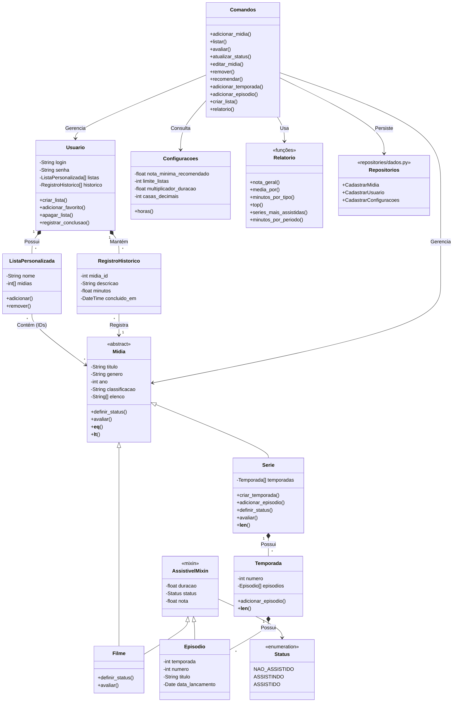

# Tema-10-Catalogo-de-Filmes

## Descrição do projeto e objetivo

<p>TotalView é um sistema em linha de comando (CLI) para gerenciar um catálogo pessoal de filmes e séries, com avaliações, status de visualização, temporadas/episódios, histórico e relatórios de consumo de mídia. Além disso, possibilita acompanhar o progresso de séries e comparar avaliações entre mídias.</p>

<p>Objetivamos o gerenciamento de mídias, permitindo cadastrar, acompanhar e avaliar filmes e séries, organizar listas e favoritos, registrar o histórico de visualização e gerar relatórios personalizados sobre o consumo e as avaliações do catálogo.</p>

## Estrutura planejada de classes

<details>
<summary>UML Textual Simplificado</summary>

**Classe: Usuario**

Atributos:
- Login
- Senha
- Listas personalizadas (inclui Favoritos)
- Histórico de visualização

Métodos:
+ Criar_lista()
+ Adicionar_favorito()
+ Apagar_lista()
+ Registrar_conclusao()
+ Remover_registros()

**Classe: Comandos (services)**

Métodos:
+ Entrar() / Sair()
+ Adicionar_midia()
+ Listar()
+ Avaliar()
+ Atualizar_status()
+ Editar_midia()
+ Remover()
+ Recomendar()
+ Adicionar_temporada() / Adicionar_episodio()
+ Criar_lista() / Adicionar_favorito()
+ Relatorio()
+ Definir_config()

**Interfaces: CLI (src/cli.py) e Menu (src/menu.py)**

As duas só leem a entrada e chamam a classe Comandos.

**Classe: Midia (abstrata)**

Atributos:
- Título
- Gênero
- Ano
- Classificação_indicativa
- Elenco[]

Métodos:
+ Definir_status()
+ Avaliar()
+ __str__() / __repr__() / __eq__() / __hash__() / __lt__()

**Classe: AssistivelMixin**

Atributos:
- Duração (> 0)
- Status
- Nota (0 a 10)

Métodos:
+ Minutos_assistidos()

**Classe: Filme (herda de AssistivelMixin e Midia)**

Métodos:
+ Definir_status()
+ Avaliar()

**Classe: Serie (herda de Midia)**

Atributos:
- Temporadas[]
- Status (calculado a partir dos episódios)

Métodos:
+ Criar_temporada()
+ Adicionar_episodio()
+ Definir_status()
+ Avaliar()
+ __len__()

**Classe: Temporada**

Atributos:
- Número
- Episódios[]

Métodos:
+ Adicionar_episodio()
+ Nota_media()
+ __len__()

**Classe: Episodio (usa AssistivelMixin)**

Atributos:
- Temporada
- Número
- Título
- Data de lançamento

**Classe: ListaPersonalizada**

Atributos:
- Nome
- Mídias[] (IDs, sem duplicatas)

Métodos:
+ Adicionar()
+ Remover()
+ __len__() / __contains__()

**Classe: RegistroHistorico**

Atributos:
- Mídia (ID)
- Descrição
- Minutos
- Data e hora da conclusão

**Classe: Configuracoes**

Atributos:
- Nota mínima para recomendação
- Limite de listas personalizadas por usuário
- Multiplicador de duração
- Casas decimais do arredondamento das horas

Métodos:
+ Horas()
+ Definir()

**Módulo: relatorio (funções)**

+ Nota_geral()
+ Media_por() (gênero ou tipo)
+ Minutos_por_tipo()
+ Top()
+ Series_mais_assistidas()
+ Minutos_por_periodo() (semana ou mês)

**Persistência: repositories (JSON), com o dados.py juntando todos**

+ CadastrarMidia, CadastrarUsuario (listas e histórico), CadastrarConfiguracoes, CadastrarSessao

</details>

<details>
<summary>Ver a estrutura</summary>



</details>

## Estrutura de pastas

```text
main.py            ponto de entrada (menu guiado ou CLI com subcomandos)
src/
  cli.py, menu.py  interfaces (entrada e saída de tela)
  domain/          classes e regras de negócio: midia, user, listas, historico, config
  services/        lógica de aplicação: comandos, relatorio, seed
repositories/      persistência dos dados em JSON (o dados.py junta os repositórios)
data/              arquivos JSON gerados pelos repositórios
tests/             testes automatizados
```

## Como executar

Precisa de Python 3.10 ou mais novo. O sistema não usa bibliotecas externas, o `pytest` só é necessário para rodar os testes.

```text
python main.py                            abre a escolha entre menu guiado e CLI com comandos
python main.py <grupo> <ação> [opções]    executa um subcomando direto
```

Os dados ficam na pasta `data/` e as configurações no `settings.json`.

## Como rodar os testes

```text
pip install -r requirements.txt
python -m pytest
```

## Exemplos de uso

Sequência para testar o sistema com o catálogo vazio (a primeira mídia cadastrada fica com ID 1). No terminal de comandos (opção 2 do `python main.py`) dá para digitar sem o `python main.py` na frente.

```text
# 1. Ajuda e login
python main.py ajuda
python main.py ajuda midia adicionar
python main.py usuario entrar Professor --senha 123
python main.py usuario quem

# 2. Cadastro de mídias
python main.py midia adicionar --tipo filme --titulo Matrix --genero "Ficção" --ano 1999 --classificacao 14 --elenco "Keanu Reeves, Carrie-Anne Moss" --duracao 136
python main.py midia adicionar --tipo serie --titulo Dark --genero "Suspense" --ano 2017 --classificacao 16
python main.py midia listar

# 3. Temporadas e episódios da série (ID 2)
python main.py serie adicionar-temporada 2 --episodios 3 --duracao 50
python main.py serie adicionar-episodio 2 -t 2 -n 1 --titulo "Piloto" --duracao 40
python main.py serie episodios 2

# 4. Status e histórico (precisa estar logado)
python main.py midia atualizar-status 1 assistido
python main.py serie atualizar-status 2 assistido -t 1 -e 1
python main.py serie atualizar-status 2 assistido -t 1
python main.py midia listar --tipo serie
python main.py serie atualizar-status 2 assistido
python main.py usuario historico

# 5. Avaliações (nota de 0 a 10)
python main.py midia avaliar 1 9.5
python main.py midia avaliar 2 8 -t 1 -e 1
python main.py midia avaliar 2 7
python main.py midia listar --status assistido

# 6. Listas e favoritos
python main.py usuario criar-lista "Para assistir"
python main.py usuario adicionar-na-lista "Para assistir" 2
python main.py usuario adicionar-favorito 1
python main.py usuario listas
python main.py usuario listas Favoritos
python main.py usuario remover-da-lista "Para assistir" 2

# 7. Relatórios
python main.py midia relatorio geral
python main.py midia relatorio notas --por genero
python main.py midia relatorio tempo
python main.py midia relatorio top
python main.py midia relatorio series
python main.py midia relatorio periodo --por semana

# 8. Configurações e recomendação
python main.py config mostrar
python main.py config definir nota_minima_recomendado 8
python main.py config definir casas_decimais 1
python main.py midia recomendar
```

Comandos que devem dar erro (regras de validação):

```text
python main.py midia adicionar --tipo filme --titulo Matrix --genero "Ficção" --ano 1999 --classificacao 14 --duracao 136    # duplicado
python main.py midia avaliar 1 11                  # nota fora de 0 a 10
python main.py midia atualizar-status 1 talvez     # status inválido
python main.py usuario sair
python main.py usuario criar-lista "X"             # sem login
```

Se quiser ver o sistema funcionando sem cadastrar nada, `python main.py exemplos` cadastra dois filmes e uma série (IDs 1, 2 e 3). Para recomeçar do zero, é só apagar os `.json` da pasta `data/`.

## Como pedir ajuda na CLI

```text
python main.py ajuda                    todos os comandos, um por linha
python main.py ajuda midia              comandos do grupo com seus argumentos
python main.py ajuda midia adicionar    detalhes de um comando
```

No terminal de comandos (opção 2 ao abrir `python main.py`) basta digitar `ajuda`, `ajuda midia` etc., sem o `python main.py`. O guia é montado a partir dos próprios subcomandos, então não tem lista de comandos escrita à mão para manter.

### Decisões de Design

```text
- Dividi Série, Temporada e Episódio, pois cada um possui características próprias que são melhores representadas separadamente.

- Duração não participa de Mídia, pois não é compatível com a estrutura de série inteira. A duração é utilizada em filmes e episódios.

- O status de uma série pode ser definido a partir dos episódios. Ao alterar o status de um nível superior, a alteração é repassada aos itens abaixo dele.

- A nota média da série e da temporada é calculada a partir das avaliações dos episódios correspondentes, sem precisar solicitar uma nota para cada episódio quando a avaliação é feita pelo escopo inteiro.

- Como Favoritos é um tipo de lista, não vejo motivo para fazer ela como uma subclasse. Por isso, ela é tratada como uma organização das mídias do usuário.

- O histórico registra o tempo assistido. Quando uma mídia volta para o status de não assistida, o registro correspondente deve ser removido para manter os relatórios corretos.

- As listas personalizadas possuem um limite configurável por usuário. As configurações também definem a nota mínima para recomendação e o multiplicador utilizado na conversão de minutos para horas.

- A CLI utiliza subcomandos para executar as operações. O menu guiado oferece uma alternativa para quem prefere navegar pelas opções sem precisar conhecer todos os comandos.

- Os dados são persistidos em arquivos JSON por meio dos repositórios, separando o armazenamento das regras de negócio.

- O tempo assistido soma só as mídias com status ASSISTIDO, como diz a regra de negócio. Uma série só entra na soma quando todos os episódios foram assistidos.

- O dados.py da especificação ficou em repositories/dados.py, que junta os repositórios num lugar só, sem repetir código.

- O arredondamento das horas é configurado pela chave casas_decimais do settings.json.
```