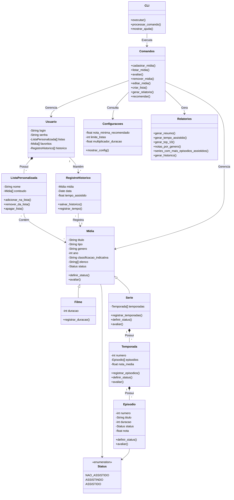

# Tema-10-Catalogo-de-Filmes

## Descrição do projeto e objetivo

<p>TotalView é um sistema em linha de comando (CLI) para gerenciar um catálogo pessoal de filmes e séries, com avaliações, status de visualização, temporadas/episódios, histórico e relatórios de consumo de mídia. Além disso, possibilita acompanhar o progresso de séries e comparar avaliações entre mídias.</p>

<p>Objetivamos o gerenciamento de mídias, permitindo cadastrar, acompanhar e avaliar filmes e séries, organizar listas e favoritos, registrar o histórico de visualização e gerar relatórios personalizados sobre o consumo e as avaliações do catálogo.</p>

## Estrutura planejada de classes

<details>
<summary>UML Textual Simplificado</summary>

**Classe: Usuario**

Atributos:
- Login
- Senha
- Listas personalizadas
- Favoritos
- Histórico de visualização

Métodos:
+ Fazer_login()
+ Criar_lista()
+ Adicionar_favorito()

**Classe: CLI**

Atributos:
- Comando
- Argumentos

Métodos:
+ Executar()
+ Processar_comando()
+ Mostrar_ajuda()

**Classe: Comandos**

Métodos:
+ Cadastrar_midia()
+ Listar_midia()
+ Avaliar()
+ Remover_midia()
+ Editar_midia()
+ Criar_lista()
+ Gerar_relatorio()
+ Mostrar_config()
+ Recomendar()

**Classe: Midia**

Atributos:
- Título
- Tipo
- Gênero
- Ano
- Classificação_indicativa
- Elenco[]
- Status

Métodos:
+ Cadastrar_midia()
+ Impedir_duplicidade()
+ Definir_status()
+ Avaliar()

**Classe: Filme (herda de Midia)**

Atributos:
- Duração

Métodos:
+ Registrar_duração()

**Classe: Serie (herda de Midia)**

Atributos:
- Temporadas[]

Métodos:
+ Registrar_temporadas()
+ Definir_status()
+ Avaliar()

**Classe: Temporada**

Atributos:
- Número
- Episódios[]
- Nota média

Métodos:
+ Registrar_episodios()
+ Definir_status()
+ Avaliar()

**Classe: Episodio**

Atributos:
- Número
- Título
- Duração
- Status de visualização
- Nota

Métodos:
+ Definir_status()
+ Avaliar()

**Classe: ListaPersonalizada**

Atributos:
- Nome
- Conteúdo[]

Métodos:
+ Criar_lista()
+ Adicionar_na_lista()
+ Remover_da_lista()
+ Apagar_lista()

**Classe: RegistroHistorico**

Atributos:
- Mídia
- Data
- Tempo assistido

Métodos:
+ Salvar_historico()
+ Registrar_tempo()

**Classe: Configuracoes**

Atributos:
- Nota mínima para recomendação
- Limite de listas personalizadas por usuário
- Multiplicador de duração

Métodos:
+ Mostrar_config()
+ Nota_min_recomendado()
+ Limite_listas()

**Classe: Relatorios**

Métodos:
+ Gerar_resumo()
+ Gerar_tempo_assistido()
+ Gerar_top_10()
+ Notas_por_genero()
+ Series_com_mais_episodios_assistidos()
+ Gerar_historico()

</details>

<details>
<summary>Ver a estrutura</summary>



</details>

## Estrutura de pastas

```text
main.py            ponto de entrada (menu guiado ou CLI com subcomandos)
src/
  cli.py, menu.py  interfaces (entrada e saída de tela)
  domain/          classes e regras de negócio: midia, user, listas, historico, config
  services/        lógica de aplicação: comandos, relatorio, seed
repositories/      acesso e persistência dos dados (JSON)
data/              arquivos JSON gerados pelos repositórios
tests/             testes automatizados
```

## Como pedir ajuda na CLI

```text
python main.py ajuda                    todos os comandos, um por linha
python main.py ajuda midia              comandos do grupo com seus argumentos
python main.py ajuda midia adicionar    detalhes de um comando
```

No terminal de comandos (opção 2 ao abrir `python main.py`) basta digitar `ajuda`, `ajuda midia` etc., sem o prefixo `python main.py`. O guia é gerado a partir dos próprios subcomandos, então não existe uma lista de comandos escrita à mão para manter.

## Requisitos técnicos atendidos

- **@property com validação** (`src/domain/midia.py`): título não vazio (`Midia`, `Episodio`), duração > 0 e nota entre 0 e 10 (`AssistivelMixin`).
- **Métodos especiais**: `__str__`, `__repr__`, `__eq__`, `__hash__`, `__lt__` em `Midia`; `__len__` em `Serie`, `Temporada` e `ListaPersonalizada`; também `__iter__` e `__contains__`.
- **Mixin e herança dupla**: `AssistivelMixin` (duração, status e nota) é combinado a `Midia` em `Filme(AssistivelMixin, Midia)` e reaproveitado por `Episodio`.
- **Camadas**: `domain` não conhece persistência nem tela; `repositories` só leem e gravam; `services` orquestram regras e repositórios.

### Decisões de Design

```text
- Dividi Série, Temporada e Episódio, pois cada um possui características próprias que são melhores representadas separadamente.

- Duração não participa de Mídia, pois não é compatível com a estrutura de série inteira. A duração é utilizada em filmes e episódios.

- O status de uma série pode ser definido a partir dos episódios. Ao alterar o status de um nível superior, a alteração é repassada aos itens abaixo dele.

- A nota média da série e da temporada é calculada a partir das avaliações dos episódios correspondentes, sem precisar solicitar uma nota para cada episódio quando a avaliação é feita pelo escopo inteiro.

- Como Favoritos é um tipo de lista, não vejo motivo para fazer ela como uma subclasse. Por isso, ela é tratada como uma organização das mídias do usuário.

- O histórico registra o tempo assistido. Quando uma mídia volta para o status de não assistida, o registro correspondente deve ser removido para manter os relatórios corretos.

- As listas personalizadas possuem um limite configurável por usuário. As configurações também definem a nota mínima para recomendação e o multiplicador utilizado na conversão de minutos para horas.

- A CLI utiliza subcomandos para executar as operações. O menu guiado oferece uma alternativa para quem prefere navegar pelas opções sem precisar conhecer todos os comandos.

- Os dados são persistidos em arquivos JSON por meio dos repositórios, separando o armazenamento das regras de negócio.
```
